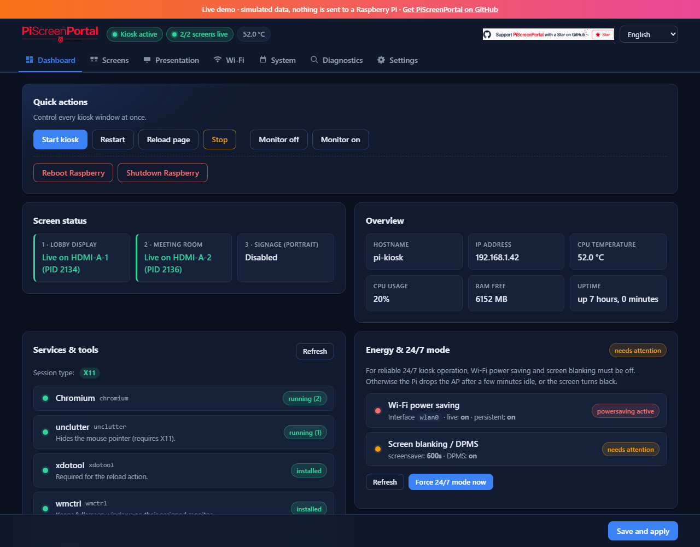
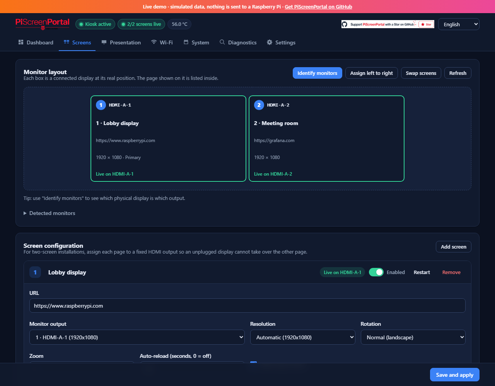

<p align="center">
  
</p>

# PiScreenPortal

> Web-based multi-monitor kiosk controller with AirPlay presentation mode for Raspberry Pi.

[](https://wexit.github.io/PiScreenPortal/docs/)
[](https://github.com/WEXiT/PiScreenPortal/releases/latest)
[](#license)
[](https://www.raspberrypi.com/)
[](https://www.python.org/)

PiScreenPortal turns a Raspberry Pi into a configurable digital signage and meeting-room appliance. Every monitor can show a different URL in full-screen Chromium kiosk mode, controlled entirely from a clean browser interface on any device in the network. A built-in AirPlay receiver (UxPlay) lets anyone mirror an iPhone, iPad or Mac to the display for ad-hoc presentations.

Raspberry Pi · Digital Signage · Kiosk Mode · Multi Monitor · AirPlay · Web Dashboard · Selfhosted

<p align="center">
  <a href="https://wexit.github.io/PiScreenPortal/docs/"><b>▶ Open the live demo</b></a>
  &nbsp;·&nbsp;
  <a href="https://wexit.github.io/PiScreenPortal/docs/#screens">Try the monitor layout</a>
  &nbsp;·&nbsp;
  <a href="https://github.com/WEXiT/PiScreenPortal/releases/latest">Latest release</a>
</p>

---

## Features

- **Multi-screen kiosk** – one URL per HDMI output, with rotation, resolution, zoom, auto-reload and cursor-hiding
- **Easy two-monitor setup** – live monitor map, *Identify monitors* (shows a big number on every display), *Assign left to right*, *Swap screens*, and warnings for double-assigned or unplugged outputs
- **Gentle apply** – saving only restarts the screens you changed; the other monitor keeps running. Each screen can also be restarted on its own
- **Hotplug-safe** – an unplugged display never takes over the other page; reconnected displays get their last working mode back
- **Web interface on port 2411** – manage everything from your phone or laptop, light and dark mode
- **AirPlay receiver** – iPhone/iPad/Mac users tap *Screen Mirroring* → presentation in seconds; the kiosk resumes automatically afterwards
- **Wi-Fi management** – scan, connect, manually add hidden SSIDs, list and remove saved profiles
- **System monitoring** – CPU temperature, load, RAM, disk, logs, running processes, display diagnosis
- **Auto-start on boot**, Chromium crash-recovery, configurable Chromium flags
- **Maintenance controls** – scheduled Raspberry reboot, app and Raspberry Pi OS updates from the web interface, and a black boot cover to hide the desktop flash
- **Bilingual UI** – English and German (follows the browser language), switchable in the header
- **Password protection** with a proper login page and session cookie (stay signed in for 14 days); the password is stored as a salted PBKDF2 hash
- **No keyring dialogs** – the GNOME keyring autostart is disabled by default and Chromium never uses the keyring (can be switched in *Settings*)
- **Crash-safe configuration** – `config.json` is written atomically and the previous version is kept as `config.json.bak`
- **Import / export configuration** as JSON

## What's new in v4.0.0

- 🖥️ **Monitor layout map**, **Identify monitors**, **Assign left to right** and **Swap screens** – two-monitor setups in a few clicks
- 📐 Per-screen **resolution** and per-screen **restart**
- 💾 **Save and apply** only restarts the screens you changed
- 🌙 Completely **redesigned web interface** with dark mode and a phone layout
- 🛡️ Crash-safe config, hashed password, protection against requests from other websites
- 🔐 **Keyring disabled by default** – no more "unlock keyring" dialog over the kiosk
- 🐛 Many fixes: first start with one monitor, rotation reset, reload, AirPlay resume, and more

Full list: [release notes](https://github.com/WEXiT/PiScreenPortal/releases/latest).

## Demo

👉 **[Live Demo](https://wexit.github.io/PiScreenPortal/docs/)** – or jump straight to the
[monitor layout](https://wexit.github.io/PiScreenPortal/docs/#screens),
[settings](https://wexit.github.io/PiScreenPortal/docs/#settings) or
[diagnostics](https://wexit.github.io/PiScreenPortal/docs/#diagnostics).

The live demo runs the real web interface against a simulated Raspberry Pi
(two monitors, Wi-Fi, updates, presentation mode). Nothing is sent anywhere;
hardware features such as real monitor detection, Chromium control, AirPlay
and system updates require a Raspberry Pi installation.

To try the demo locally:

```bash
python3 -m http.server 8765 --directory docs
```

Then open `http://localhost:8765`.

## Screenshots

<p align="center">
  <a href="https://wexit.github.io/PiScreenPortal/docs/"></a>
  <a href="https://wexit.github.io/PiScreenPortal/docs/#screens"></a>
</p>

## Requirements

- Raspberry Pi 4 or 5
- Raspberry Pi OS 64-bit (Bookworm or Trixie), *with desktop*
- One or more HDMI monitors

## Installation

### Automatic (via GitHub)

```bash
rm -rf ~/PiScreenPortal && git clone https://github.com/WEXiT/PiScreenPortal.git ~/PiScreenPortal && cd ~/PiScreenPortal && chmod +x install.sh && bash install.sh
```

### Manual (step by step)

#### 1. Prepare the Raspberry Pi

Flash the SD card with the official **Raspberry Pi Imager**, choose *Raspberry Pi OS (64-bit) with desktop*. In the imager's *advanced settings*:

- Hostname: `pi-kiosk` (or any name you like)
- Enable SSH with password
- Configure Wi-Fi (SSID + password)
- Username: `admin`, set a password

Boot the Pi – that's all the OS-level preparation required.

#### 2. Copy the project to the Pi

**macOS / Linux**

```bash
scp -r /path/to/PiScreenPortal/ admin@<PI-IP>:~/
```

**Windows – WinSCP (graphical):**

1. Install [WinSCP](https://winscp.net)
2. New session → protocol **SCP**, host = Pi IP, user `admin`, password
3. Drag the local `PiScreenPortal` folder to the Pi's home directory

**Windows – PowerShell:** Windows 10/11 ships with `scp`:

```powershell
scp -r C:\path\to\PiScreenPortal admin@<PI-IP>:~/
```

#### 3. Install

SSH into the Pi and run the installer:

```bash
ssh admin@<PI-IP>
cd ~/PiScreenPortal
chmod +x install.sh
./install.sh
```

The installer handles everything:

- Chromium (kiosk browser)
- `unclutter`, `xrandr`, `xdotool`, `wmctrl`, `iw`, Avahi
- UxPlay (AirPlay receiver) – from apt or built from source
- Python virtual environment + Flask + QR-code support (checks Python ≥ 3.9 and repairs a venv broken by an OS upgrade)
- Sudo rules for `reboot`, `shutdown`, `nmcli`, `apt`
- systemd service (autostart at boot)
- Keyring autostart disabled (existing keyrings are moved to a backup, not deleted)
- 24/7 mode: Wi-Fi power saving and screen blanking off
- Desktop shortcut on the Pi

It finishes with a small Python dependency check (`>>> Python deps ok: Flask …`).

#### 4. Start and open the web interface

```bash
sudo systemctl start pi-kiosk
```

Open in a browser:

- **From another device on the same network:** `http://<PI-IP>:2411`
- **Directly on the Pi:** double-click the *PiScreenPortal* icon on the desktop

That's it. Configure your screens under the *Screens* tab and hit *Save and apply*.

### Two or more monitors

1. Open **Screens**. The *Monitor layout* map shows every connected display at
   its real position and which page runs on it.
2. Click **Identify monitors** – each display shows its number and output name
   (e.g. `1 · HDMI-A-1`) for 10 seconds.
3. Click **Assign left to right** (or pick the output per screen). With exactly
   two screens, **Swap screens** exchanges them in one click.
4. Optional per screen: **Resolution** (e.g. 1080p on a 4K TV to keep the Pi
   fast) and **Rotation** for portrait displays.
5. **Save and apply** – only screens whose settings changed are restarted.

The first start also works with fewer monitors than screens: free displays
are used right away, and the final assignment is stored once all displays are
connected. A saved assignment is never moved to another monitor, so an
unplugged display cannot take over the other page.

PiScreenPortal watches the output layout, activates a reconnected display as
an extended desktop, and restores only the affected Chromium window. The page
on the monitor that remained connected keeps running. Confirmed display modes
are cached by EDID and output, so a reconnected monitor can reuse its last
working mode. If that mode is no longer advertised or accepted, the layout
automatically falls back to `xrandr --auto`.

---

## Using presentation mode

1. Open the **Presentation** tab → *Start presentation*
2. On **iPhone / iPad / Mac**: Control Center → *Screen Mirroring* → select `PiScreenPortal`
3. When done, click *Stop presentation* – the kiosk resumes automatically (also if UxPlay stops on its own)

For Windows or Android (no native AirPlay) use [Deskreen](https://www.deskreen.com) as an alternative receiver.

---

## Updates

When installed from GitHub, open *Settings → Updates* and click
*Scan app updates*. PiScreenPortal compares the local `VERSION` file with
`origin/main:VERSION` and shows whether an update is available. Click
*Update from Git & reboot* to pull `origin/main` from
`https://github.com/WEXiT/PiScreenPortal.git` and reboot the Raspberry. If
`requirements.txt` changed, the updater installs the new Python dependencies
into the virtual environment before the reboot.

Raspberry Pi OS packages can be scanned and installed in the same card
(*Scan Raspberry updates* / *Install Raspberry updates*).

Via SSH:

```bash
cd ~/PiScreenPortal && git pull --ff-only origin main && sudo systemctl restart pi-kiosk
```

**Publishing a new version:** increment the number in `VERSION` (the updater
compares this file), commit and push it with the code changes, then optionally
create a GitHub release (`v4.0.0`, `v4.1.0`, …).

## Service management

```bash
sudo systemctl status pi-kiosk      # is it running?
sudo systemctl restart pi-kiosk     # restart
sudo systemctl stop pi-kiosk        # stop
sudo systemctl disable pi-kiosk     # disable auto-start
journalctl -u pi-kiosk -f           # live logs
tail -f ~/PiScreenPortal/kiosk.log  # application log
```

`kiosk.log` rotates automatically at 2 MiB and keeps three backups
(`kiosk.log.1` through `kiosk.log.3`), limiting the application logs to roughly
8 MiB in total.

## Configuration file

Stored at `~/PiScreenPortal/config.json`. You can also export/import it via the *Settings* tab.
Every save is atomic; the previous version is kept as `config.json.bak` and is
loaded automatically if `config.json` is ever damaged (for example by a power
cut). The web password is only stored as a hash (`auth.password_hash`);
configurations from older versions with a plain-text password are converted
on the next start.

The automatically managed `display_cache.json` stores the last confirmed mode
for each HDMI output and EDID. It is safe to delete; PiScreenPortal recreates it
after the next successful monitor query.

## Troubleshooting

| Problem | Fix |
|---|---|
| Web interface not reachable | `sudo systemctl status pi-kiosk`; check `journalctl -u pi-kiosk -n 50` |
| No monitors detected | Check `xrandr --query` on the Pi. If it fails, the session isn't exposing outputs; reboot once and try again. |
| Chromium on wrong monitor | *Screens → Identify monitors*, then set the output explicitly or use *Assign left to right* |
| Pages swapped between the two monitors | *Screens → Identify monitors*, then *Swap screens* and *Save and apply* |
| A page is missing on one monitor | *Diagnostics → Run analysis now* while the page is missing; it shows outputs, Chromium windows and the latest log |
| AirPlay device not visible | `systemctl status avahi-daemon` must be running; check firewall |
| Keyring "unlock" dialog on the screen | *Settings → General → Disable GNOME keyring* (on by default), then reboot once. The installer moves old keyrings to `~/.local/share/keyrings.piscreenportal-backup-*` instead of deleting them. |
| Lost password | Edit `~/PiScreenPortal/config.json` → set `auth.enabled` to `false`, restart service |

## Uninstall

```bash
sudo systemctl disable --now pi-kiosk
sudo rm /etc/systemd/system/pi-kiosk.service
sudo rm /etc/sudoers.d/pi-kiosk
sudo systemctl daemon-reload
rm -rf ~/PiScreenPortal ~/Desktop/PiScreenPortal.desktop
```

---

## Technology stack

- **Backend:** Python 3 + Flask (single-file `app.py`)
- **Frontend:** vanilla JS, no build step, custom lightweight i18n
- **Kiosk:** Chromium with `--kiosk` and `--window-position`
- **AirPlay:** [UxPlay](https://github.com/FDH2/UxPlay)
- **Monitor layout:** `xrandr`
- **Wi-Fi:** `nmcli` (NetworkManager)

## Project structure

```
PiScreenPortal/
├── app.py              # Flask backend + kiosk manager
├── requirements.txt
├── install.sh          # one-shot installer
├── pi-kiosk.service    # systemd unit template
├── static/
│   ├── app.js          # frontend logic
│   ├── i18n.js         # translations (en, de)
│   └── style.css
├── templates/
│   ├── index.html
│   └── login.html
├── docs/               # GitHub Pages demo (generated, except demo-api.js)
│   └── screenshots/    # README screenshots taken from the demo
├── tools/
│   └── build_demo.py   # regenerates docs/ from templates/ + static/
└── tests/              # unit tests (python3 -m unittest discover -s tests)
```

## Development

```bash
python3 -m unittest discover -s tests   # run the tests (works with or without Flask installed)
python3 tools/build_demo.py             # refresh the demo after UI changes
```

## TAGS
raspberry-pi flask stream pi kiosk raspberry airplay multi-monitor digital-signage kiosk-mode web-dashboard chromium-kiosk piscreenportal pi-kiosk

## License

MIT © Dennis Reuther 2026
